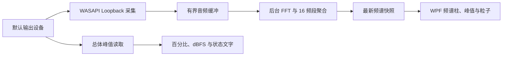

# Audio Meter：16 柱音乐频谱设计框架

本文用于交接给实现 agent，仅定义整体设计与验收要求，不包含完整代码。

## 1. 目标与技术约束

将现有 Audio Meter 升级为具有旧式 CD 播放器观感的实时音乐频谱：16 根彩色频谱柱、独立峰值标记、柱顶飘散粒子。保留总体电平百分比、dBFS 和状态文字，用频谱区域替换现有横向电平条。

- 保持项目的 `.NET 8 WPF` 架构，不升级运行时。
- 用户已确认允许引入 NAudio，依赖固定为 **NAudio 2.2.1**。该版本具有兼容 .NET 8 的目标框架；不要直接安装最新版 NAudio。
- **NAudio 3.x 要求 .NET 9 或以上**，本方案不使用 3.x API。实现时参考 2.2.1 对应版本的接口与源码，避免混用最新主分支文档。
- 默认监测 Windows 默认输出设备的混合声音，跟随扬声器、耳机和蓝牙设备切换。
- 第一版采用一种固定视觉样式，不纳入麦克风、应用单独采集、左右声道分别显示、圆形频谱和主题切换。

版本依据：[NAudio 2.2.1 的 NuGet 目标框架](https://www.nuget.org/packages/NAudio/2.2.1)、[NAudio 3.x 的运行时要求](https://www.nuget.org/packages/NAudio)。

## 2. 系统结构与数据流

| 组件 | 职责 |
| --- | --- |
| `AudioMeterModule` | 协调采集、显示状态和生命周期，沿用 `audio-meter` 模块 ID 与设置开关 |
| `WasapiAudioCaptureSource` | 封装 NAudio、默认设备监听、音频格式转换和设备恢复 |
| `SpectrumAnalyzer` | 独立计算 FFT、频段能量与归一化高度，不依赖 WPF |
| `AudioSpectrumView` | 自定义 WPF 绘制控件，负责柱形平滑、峰值保持、粒子和辉光 |

新增 `SpectrumFrame` 数据类型，包含采集时间、16 个归一化频段值和有效状态。发布后不得修改；UI 只读取最新快照，避免音频更新积压。

频谱属性放在 `AudioMeterModule` 上，无需扩展所有模块使用的 `IInfoModule`。增加模块级“展示是否活跃”的入口，供面板展开、收起及托盘隐藏时调用。

## 3. 音频采集与频谱分析

### 3.1 采集层

- 使用 NAudio 2.2.1 的 `WasapiLoopbackCapture`，显式绑定默认 `Render / Console` 设备，保持与现有 Audio Meter 一致。
- 通过共享模式捕获设备输出混音。WASAPI Loopback 用于获取输出设备正在播放的声音，无需录制到文件。
- 根据实际采样率、声道数和音频格式解码，覆盖常见浮点与 PCM 格式，不假定固定为 48kHz、双声道。
- 音频回调只负责将数据复制到有界缓冲并唤醒分析线程，不执行 FFT、不更新 WPF 控件。缓冲溢出时丢弃最旧数据，优先保证实时性。
- 默认设备变更与采集异常统一进入串行恢复流程。每次采集会话使用独立标识，忽略旧设备迟到的回调。
- 无设备或初始化失败时显示明确状态，按 1、2、5 秒退避重试，之后保持每 5 秒重试；停止模块时取消重试。

采集原理参考：[Microsoft WASAPI Loopback Recording](https://learn.microsoft.com/en-us/windows/win32/coreaudio/loopback-recording)。

### 3.2 分析层

- 默认使用 **4096 点 FFT、Hann 窗、50% 重叠**，按实际采样率计算频率位置。
- 16 个频段按对数频率划分，默认覆盖 **40Hz–16kHz**；上限不得超过奈奎斯特频率。
- 各声道分别计算频谱，再平均功率，避免左右声道反相时因直接相加而消失。
- 每个频段聚合所覆盖 FFT 仓的功率，经对数压缩映射到 `0–1`。对空仓或低频分辨率不足的频段使用相邻仓插值。
- 初始显示动态范围采用约 `-70～-10dB`，作为内部可调常量。分析值需按 FFT 与窗函数正确归一化，频谱显示刻度与总体 dBFS 读数分开处理。
- 不持续自动拉满低音量数据，避免静音噪声占满画面。连续缺少音频数据时主动将频谱衰减至零；无需通过播放额外声音来维持回调。
- 总体电平继续读取端点峰值，频谱不可用时仍可展示原有数字信息。

## 4. 视觉与面板集成

参考 [UD5 音乐频谱可视化](https://www.ud5.com/tool/music-spectrum-visualizer) 的深色底板、彩虹配色和柱顶亮点，适配当前约 260px 宽的面板。网站演示数据仅作为视觉参考，产品频谱必须响应真实音频。

- **频谱区域**：高度约 80px，顶部预留粒子空间；16 柱等距排列，柱间约 3px，宽度随控件实际尺寸分配。
- **颜色**：从左至右红、橙、黄、绿、青、蓝、紫；每柱底部较暗、顶部较亮，叠加轻微辉光。
- **运动**：按经过时间计算平滑，默认快速上升约 40ms、缓慢下降约 180ms，避免不同帧率下运动速度改变。
- **峰值标记**：每柱顶部独立小光点，保持约 250ms 后缓慢下落；与飘散粒子分别维护。
- **粒子**：频段突然增强时从柱顶产生少量亮点，轻微横向漂移并向上飘散，约 300–600ms 内淡出；全控件最多 64 个，限制发射频率，静音时停止生成。
- **绘制**：使用一个自定义 `FrameworkElement` 和 `DrawingContext`；复用画刷、几何和粒子存储，避免每柱、每粒子创建独立动画控件。可见时以约 30 FPS 更新。
- **布局**：频谱控件仅出现在 Audio Meter 卡片内。面板高度计算为该卡片额外预留约 80px，继续遵循现有高度上限及滚动逻辑。
- **状态**：保留 `Level`、dBFS、`Silent / Active`；采集失败显示“频谱暂不可用”，不可用时不生成模拟频谱。

面板收起或窗口隐藏时暂停频谱采集、FFT 和粒子绘制，保留轻量总体电平监测；重新展开后创建新采集会话。模块禁用或应用退出时停止全部资源。

渲染事件必须在控件卸载时解除订阅。`StopAsync()` 等待采集和分析任务结束，停止过程不得阻塞 UI，避免退出死锁。初始化、停止和恢复过程均须支持重复调用及快速交替操作。

## 5. 实现顺序与验收

按“采集与恢复 → FFT 与快照 → 频谱控件 → 粒子与布局 → 验收”交付，先验证真实音频数据，再接视觉效果。

### 验收场景

- 用已知低、中、高频正弦信号验证能量分别出现在对应频段；左右反相信号仍能显示。
- 音乐播放时 16 柱具有不同响应，停止播放后柱形、峰值和粒子自然消退。
- 启动时无输出设备、插拔耳机、切换蓝牙、改变采样率后能够恢复，无旧设备残留数据。
- 连续展开、收起、隐藏和开关模块，不重复创建采集器、不累积渲染订阅。
- 面板只启用 Audio Meter 时也能完整显示频谱；常见 DPI 缩放下不裁切、不横向溢出。
- 连续运行 30 分钟无持续内存增长，拖动面板和打开 Settings 保持流畅；记录可见及收起状态的 CPU、内存和延迟，确认收起后的频谱开销明显下降。
- 在 .NET 8 下完成 Debug/Release 构建，并验证发布产物包含 NAudio 所需程序集。

### 交付要求

实现 agent 应交付完整实现、依赖与功能说明、验收结果，以及实际频谱截图或短录屏。保留工作区既有改动，并如实记录采集失败与驱动限制。本文中的视觉与分析参数作为初始默认值，允许依据实际验收结果微调并记录原因。
